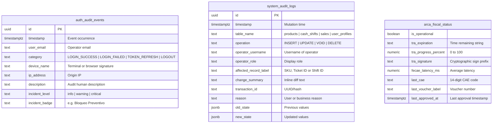
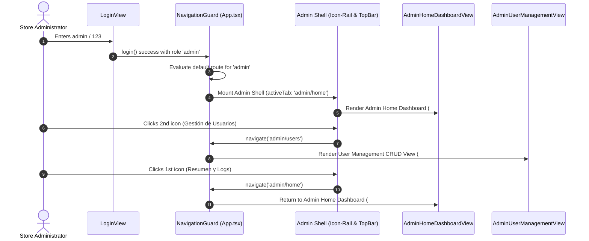

# System Specification: Admin Home Dashboard & System Observability

## 1. Executive Summary

- **Objective:** Establish the comprehensive Admin Home Dashboard (Observability, Telemetry & Audit Logs) adapted from the approved Stitch UI designs (`specifications/admin-home/code.html` and `specifications/admin-home/DESIGN.md`), designating this view as the default landing interface for authenticated administrators, fully isolated from seller accounts, with persistent sidebar navigation across the administrative workspace.
- **Scope (In-Scope):**
  - **RF#1 Admin Home Observability UI:** Executive administrative dashboard integrating:
    - 4 System Health KPI cards: Active Concurrent Sessions (`badge`), 24h Security Events with incident details (`shield_lock`), Database Latency & Connections (`lan`), and API/Sync Error Rate with sparkline trend (`bolt`).
    - Real-time Authentication Events Live Feed (`auth.audit_events`) with event category tabs (`ALL`, `ALERT`, `LOGIN_SUCCESS`, `TOKEN_REFRESH`), feed pause/resume control, and detailed metadata (timestamps, IP addresses, client agents, and incident banners).
    - External Integrations Health Monitor covering Argentine ARCA fiscal service (AFIP WSAA/WSFEv1 TRA token validity meter, FECAE latency, last authorized CAE code) and CDN/Multimedia storage capacity (Cloudinary/S3 bucket usage, edge cache hit rate).
    - Database CDC Audit Trail (`system_audit_logs`) featuring table-level filtering (`sales`, `cash_shifts`, `products`, `user_profiles`), status chips (`INSERT`, `UPDATE`, `VOID`), and interactive expandable JSON diff viewers (OLD vs NEW state).
  - **RF#2 Strict Administrator Access Control:** The Admin Home Dashboard is exclusively restricted to users authenticated with the `admin` role. Cashier and seller sessions attempting to access `#admin/home` or `#admin/overview` are immediately rejected.
  - **RF#3 Default Admin Landing Route:** Upon successful login with administrator credentials (`admin` / `123`), the system redirects immediately to `#admin/home` as the default landing view.
  - **RF#4 Seamless Admin Sidebar Navigation:** The first icon in the administrative icon-rail sidebar (`Resumen y Logs` / `BarChart3`) provides direct, reactive routing to `#admin/home`, allowing effortless navigation back and forth between the Home Dashboard and the User Management CRUD directory (`#admin/users`).
  - **RF#5 Extensible Mock State Architecture:** All telemetry metrics, live feed rows, external integration gauges, and audit logs are powered by a structured client-side store designed with strict TypeScript interfaces that map 1:1 to future Supabase real-time tables, Edge Functions, and CDC triggers.
- **Out-of-Scope:**
  - Active WebSocket listener connection to live remote Supabase PostgreSQL instances (simulated via client-side mock store in this phase).
  - Direct transmission of SOAP requests to Argentine ARCA/AFIP servers or Cloudinary REST APIs.
  - Automated test scripting (per strict repository engineering principles; verification is manual in browser).
- **Assumptions:**
  - Built with React 19, TypeScript, Vite, Tailwind CSS v4, Lucide React icons, and TanStack Query v5.
  - The Admin layout shell uses a persistent 80px (`w-20`) left icon-rail and top bar with "Portal Administrador", "Super Admin" badges, and dark mode support.

---

## 2. Actors and User Roles

| Role Identifier | Role Label | Permitted Admin Views | Access to Admin Home | Landing View on Login |
| :--- | :--- | :--- | :--- | :--- |
| **`admin`** | Super Admin / Admin root | `#admin/home`, `#admin/users`, `#admin/backup`, `#admin/config` | **Full Access (Exclusive)** | `#admin/home` |
| **`seller`** | Carlos Vendedor | `#seller/home`, `#pos`, `#catalog`, `#drawer`, `#history` | **Blocked (Redirects to `#seller/home`)** | `#seller/home` |
| **`cashier`** | Cajero Operativo | POS Terminal (`#pos`), Drawer settlement (`#drawer`) | **Blocked** | `#pos` |
| **`supervisor`** | Supervisor de Tienda | POS Terminal, Price Checker, Manager Overrides | **Blocked from Admin Shell** | `#seller/home` |

---

## 3. Functional Requirements & User Stories

### Epic 1: Admin Home Landing & Route Protection

#### [RF-01] Default Admin Authentication Landing Route
- **Story:** As a store administrator, I want to land directly on the Admin Home Dashboard upon login so that I can immediately inspect system health, active cashier shifts, and recent security incidents.
- **Criterios de Aceptación (Gherkin):**
  - [ ] **Scenario 1 (Admin Login Redirects to Home Dashboard):**
    - **Given** an unauthenticated session on `#login`
    - **When** the user enters username `"admin"` and password `"123"` and submits
    - **Then** the authentication provider resolves session role `"admin"`
    - **AND** the navigation router redirects the browser directly to `#admin/home`
    - **AND** the Admin Home Dashboard mounts with real-time telemetry and KPI cards.
  - [ ] **Scenario 2 (Session Restoration to Admin Home):**
    - **Given** an active authenticated session with role `"admin"`
    - **When** the browser is reloaded on `#` or navigated to `/`
    - **Then** the router preserves session state and routes the user to `#admin/home`.

#### [RF-02] Strict Role-Based View Isolation
- **Story:** As a security auditor, I want strict route guards preventing non-admin personnel from accessing the Admin Home Dashboard so that sensitive system logs, security alerts, and financial audit trails remain confidential.
- **Criterios de Aceptación (Gherkin):**
  - [ ] **Scenario 1 (Seller Access Blocked):**
    - **Given** an active authenticated session with role `"seller"`
    - **When** the seller manually types `#admin/home` into the browser URL
    - **Then** the router navigation guard intercepts the attempt, prevents view mounting, and redirects to `#seller/home`.
  - [ ] **Scenario 2 (Unauthenticated Access Blocked):**
    - **Given** no active session in storage
    - **When** attempting to visit `#admin/home`
    - **Then** the router redirects the browser to `#login`.

#### [RF-03] Administrative Icon-Rail Sidebar Routing
- **Story:** As an administrator, I want to click the first icon (`Resumen y Logs`) on the sidebar to return to the Home Dashboard at any time so that I can seamlessly switch between user management and system observability.
- **Criterios de Aceptación (Gherkin):**
  - [ ] **Scenario 1 (Navigate from User CRUD to Admin Home):**
    - **Given** an administrator currently on the User Management directory (`#admin/users`)
    - **When** clicking the first icon button (`Resumen y Logs`) on the left icon-rail
    - **Then** the application changes the URL hash to `#admin/home`
    - **AND** transitions the view to the Admin Home Dashboard while highlighting the first icon as active.
  - [ ] **Scenario 2 (Navigate from Admin Home to User CRUD):**
    - **Given** an administrator on the Admin Home Dashboard (`#admin/home`)
    - **When** clicking the second icon button (`Gestión de Usuarios`) on the sidebar
    - **Then** the application changes the URL hash to `#admin/users` and renders the User Directory table.

---

### Epic 2: Telemetry Metrics & Observability Bento

#### [RF-04] System Health KPI Overview Bento
- **Story:** As an administrator, I want to review 4 summary KPI cards at the top of the dashboard so that I have immediate visibility over active operators, security flags, database latency, and API error rates.
- **Criterios de Aceptación (Gherkin):**
  - [ ] **Scenario 1 (Active Sessions Card):**
    - **Given** the Admin Home Dashboard view
    - **Then** renders the *Sesiones Activas* card displaying the total concurrent sessions (e.g., `14`), growth indicator (`+2 vs 1h`), and role breakdown (`9 cajeros en TPV • 3 supervisores • 2 admins`).
  - [ ] **Scenario 2 (Security Events Card):**
    - **Given** recent authentication logs
    - **Then** renders the *Eventos de Seguridad (24h)* card in high-contrast alert styling displaying incident counts (e.g., `7`), failed retry details, and flagged source IP (`IP 190.224.88.14 (Sucursal #104)`).
  - [ ] **Scenario 3 (Database Latency Card):**
    - **Given** connected service metrics
    - **Then** renders the *Latencia DB & Conexiones* card showing response time in milliseconds (e.g., `28 ms`), health badge (`Saludable`), and auxiliary service statuses (`ARCA: Online 99.8% • Cloudinary: 42% cuota`).
  - [ ] **Scenario 4 (API Error Rate & Sparkline Card):**
    - **Given** API telemetry records
    - **Then** renders the *Tasa de Errores API / Sync* card displaying error percentage (e.g., `0.04%`), success volume (`99.96% éxito (18.4k reqs)`), offline pending counter (`0 offline pend.`), and an inline SVG sparkline graph.

---

### Epic 3: Live Authentication Events Feed

#### [RF-05] Real-Time Authentication Audit Stream & Filtering
- **Story:** As an administrator, I want a live stream of login, token refresh, and logout events with category filtering so that I can monitor personnel activity and detect unauthorized access attempts.
- **Criterios de Aceptación (Gherkin):**
  - [ ] **Scenario 1 (Filter Event Categories):**
    - **Given** the Live Authentication Feed containing mixed events
    - **When** clicking the *"Fallidos / Alertas"* filter pill
    - **Then** the list updates to display only `LOGIN_FAILED` and security incident rows with incident banners.
    - **When** clicking *"LOGIN_SUCCESS"* or *"TOKEN_REFRESH"*
    - **Then** the list filters to display only events matching the chosen category.
  - [ ] **Scenario 2 (Pause and Resume Feed):**
    - **Given** an active event feed
    - **When** clicking the *"Pausar Feed"* button
    - **Then** the button toggles to *"Reanudar Feed"* with warning highlight, pausing real-time simulated updates until clicked again.
  - [ ] **Scenario 3 (Event Detail Metadata Display):**
    - **Given** any event row in the feed
    - **Then** the row displays exact timestamp (`HH:MM:SS`), operator email, category badge, terminal/client device name (`MacBook Pro`, `TPV-02`, `iPad Air`), IP address, and descriptive audit explanation.

---

### Epic 4: External Integrations & Fiscal Services Monitor

#### [RF-06] Argentine ARCA (AFIP) Fiscal Service Health Widget
- **Story:** As a store administrator, I want to monitor the health of Argentine ARCA electronic invoicing so that I know whether WSAA access tokens are valid and Point of Sale terminals can authorize fiscal invoices.
- **Criterios de Aceptación (Gherkin):**
  - [ ] **Scenario 1 (TRA Access Token Expiration Meter):**
    - **Given** the ARCA Fiscal Service widget
    - **Then** renders the Access Ticket (*TRA*) validity bar with remaining time (e.g., `Expira en 04h 28m`), percentage progress bar (e.g., `63%`), and cryptographic signature preview (`Sign: wsaa_sig_8f3a9e...`).
  - [ ] **Scenario 2 (FECAE Latency & Last Authorization Details):**
    - **Given** recent fiscal voucher transactions
    - **Then** displays average FECAE latency (e.g., `312 ms`), the last authorized CAE code (`74192837491023`), and invoice reference (`Factura B #0004-00018921`).
  - [ ] **Scenario 3 (Fiscal Diagnostics Actions):**
    - **Given** action buttons *"Renovar TRA"* and *"Ping WSFEv1"*
    - **When** clicked by the administrator
    - **Then** triggers simulated diagnostic ping with instant feedback toast.

#### [RF-07] CDN & Storage Capacity Widget
- **Story:** As an administrator, I want to check Cloudinary and S3 storage capacity so that I can prevent product catalog image upload failures.
- **Criterios de Aceptación (Gherkin):**
  - [ ] **Scenario 1 (Capacity Meter & Edge Hit Rate):**
    - **Given** the CDN & Multimedia widget
    - **Then** renders used vs total capacity (`8.4 GB / 20 GB (42%)`), visual progress bar, total catalog image count (`1,480 imágenes`), and edge cache hit rate (`99.4% Edge Cache Hit`).

---

### Epic 5: Database Change Data Capture (CDC) Audit Trail

#### [RF-08] Interactive CDC Audit Trail Table with Expandable Diff
- **Story:** As an administrator, I want an immutable chronological log of database row updates with expandable JSON diffs so that I can track price adjustments, cash shift closures, and voided sales tickets.
- **Criterios de Aceptación (Gherkin):**
  - [ ] **Scenario 1 (Filter by Database Table):**
    - **Given** the CDC Audit Trail table
    - **When** clicking a table filter pill (`sales`, `cash_shifts`, `products`, `user_profiles`, or `Todas`)
    - **Then** the table filters rows to show only mutations affecting the selected table name.
  - [ ] **Scenario 2 (Expand and Inspect JSON Mutation Diff):**
    - **Given** an audit log row (e.g., product price update)
    - **When** the administrator clicks the row or the expand chevron icon
    - **Then** an accordion row smoothly expands displaying the transaction ID, modification reason, and side-by-side JSON panels for `Valores Anteriores (OLD)` and `Nuevos Valores (NEW)`.
    - **When** clicked again, the diff row collapses.

---

## 4. Architecture and Data Model (High-Level)

### 4.1 System Entities & Mock Schema Blueprint

The module prepares the client-side domain models matching PostgreSQL tables and Supabase Realtime CDC channels:



### 4.2 TypeScript Type Definitions (`src/types/adminDashboard.ts`)

```typescript
export type AuthEventCategory = 'ALL' | 'LOGIN_SUCCESS' | 'LOGIN_FAILED' | 'TOKEN_REFRESH' | 'LOGOUT' | 'ALERT';

export interface AuthAuditEvent {
  id: string;
  timestamp: string; // "18:42:15"
  userEmail: string;
  category: 'LOGIN_SUCCESS' | 'LOGIN_FAILED' | 'TOKEN_REFRESH' | 'LOGOUT';
  deviceName: string;
  ipAddress: string;
  description: string;
  incidentLevel?: 'info' | 'warning' | 'critical';
  incidentBadge?: string;
  incidentDetail?: string;
}

export type AuditOperation = 'INSERT' | 'UPDATE' | 'VOID' | 'DELETE';
export type AuditTableTarget = 'ALL' | 'products' | 'cash_shifts' | 'sales' | 'user_profiles';

export interface SystemAuditLog {
  id: string;
  timestamp: string; // "18:38:09"
  tableName: 'products' | 'cash_shifts' | 'sales' | 'user_profiles';
  operation: AuditOperation;
  operatorUsername: string;
  operatorRole: string;
  affectedRecordLabel: string;
  changeSummary: string;
  transactionId: string;
  reason?: string;
  oldState?: Record<string, unknown>;
  newState?: Record<string, unknown>;
}

export interface ArcaStatus {
  isOperational: boolean;
  traExpiration: string;
  traProgressPercent: number;
  traSignature: string;
  fecaeLatencyMs: number;
  lastCae: string;
  lastVoucherLabel: string;
  lastApprovedAt: string;
}

export interface CdnStorageStatus {
  usedGb: number;
  totalGb: number;
  usagePercent: number;
  catalogImagesCount: number;
  edgeCacheHitRate: number;
}

export interface SystemKpiMetrics {
  activeSessions: {
    total: number;
    trendLabel: string;
    breakdown: string;
  };
  securityEvents24h: {
    total: number;
    breakdown: string;
    flaggedIp: string;
  };
  dbLatency: {
    ms: number;
    statusBadge: string;
    auxiliaryServices: string;
  };
  errorRate: {
    percentage: number;
    successRequestsVolume: string;
    pendingOfflineCount: number;
  };
}
```

### 4.3 Navigation & View Architecture Flow



---

## 5. Non-Functional Requirements (NFRs)

- **Security & Authorization:**
  - Route guards enforce that only `user.role === 'admin'` can mount `#admin/home`.
  - Non-admin tokens are strictly barred from rendering administrative telemetry, preventing inspection of network IPs, CAE codes, or internal hashes.
- **Performance & Responsiveness:**
  - Audit trail expansion and live feed filtering must render with `< 16ms` latency (maintaining 60 FPS).
  - The dashboard must adapt seamlessly from 1920px desktop viewports down to tablet/mobile viewports (`< 768px`) using responsive CSS grid layouts.
- **Design System Fidelity:**
  - Strictly adheres to the Material-inspired *Kinetic Retail POS* tokens defined in `specifications/admin-home/DESIGN.md`:
    - **Surfaces:** `#faf8ff` (surface), `#f2f3ff` (surface-container-low), `#eaedff` (surface-container), `#ffffff` (surface-container-lowest).
    - **Accents:** `#006194` (primary), `#007bb9` (primary-container), `#0051d5` (secondary), `#00855b` (tertiary / success), `#ba1a1a` (error).
    - **Fonts:** Space Grotesk (headlines), Hanken Grotesk (body text), JetBrains Mono (timestamps, numbers, IP addresses, CAE codes).
- **Extensibility & Clean Architecture:**
  - Data hooks in `src/services/adminDashboardStore.ts` must use TanStack Query v5 patterns, decoupling UI presentation from backend transport and preparing for straightforward migration to Supabase Realtime channels.

---

## 6. Implementation Plan (Phases)

### Phase 1: Types & Navigation Router Extension
1. Create `src/types/adminDashboard.ts` with domain interfaces (`AuthAuditEvent`, `SystemAuditLog`, `ArcaStatus`, `CdnStorageStatus`, `SystemKpiMetrics`).
2. Extend `NavigationTab` in `src/types/pos.ts` with `'admin/home'`.
3. Update `ADMIN_TABS` in `src/App.tsx` to include `['admin/home', 'admin/users']`.
4. Update login redirect and default admin landing logic in `App.tsx` and `LoginView.tsx` from `'admin/users'` to `'admin/home'`.

### Phase 2: Administrative Dashboard Store & Mock Data
1. Create `src/services/adminDashboardStore.ts` leveraging TanStack Query:
   - Seed with initial datasets from `specifications/admin-home/code.html` (5 auth events, 4 KPI metrics, ARCA status, CDN metrics, and 4 audit trail logs with JSON diffs).
   - Provide query hooks: `useAdminKpiMetrics()`, `useAuthAuditFeed()`, `useExternalIntegrations()`, and `useDatabaseAuditTrail()`.
   - Implement action simulations: `toggleFeedState()`, `renewTraToken()`, and `pingWsfe()`.

### Phase 3: Admin Home Dashboard Component Implementation
1. Create `src/components/AdminHomeDashboardView.tsx`:
   - Metric Overview Bento (4 cards with Lucide icons: `BadgeCheck`, `ShieldAlert`, `Network`, `Zap`).
   - Split Canvas:
     - Left (60%): Live Auth Events Feed with interactive category filter pills (`ALL`, `ALERT`, `LOGIN_SUCCESS`, `TOKEN_REFRESH`), pause/resume toggle, and incident banners.
     - Right (40%): ARCA Fiscal Monitor (TRA meter, FECAE latency, action buttons) and CDN capacity meter.
   - Bottom Section: Database CDC Audit Trail with table filter pills and expandable JSON diff accordions.
2. Unify administrative layout navigation:
   - Ensure the sidebar's 1st icon links to `#admin/home` and the 2nd icon links to `#admin/users` across both `AdminHomeDashboardView.tsx` and `AdminUserManagementView.tsx`.
   - Update `App.tsx` to switch dynamically between `AdminHomeDashboardView` and `AdminUserManagementView` based on `currentTab`.

### Phase 4: Manual Verification & QA
1. Verify admin login immediately loads `#admin/home`.
2. Verify clicking sidebar icons alternates smoothly between `#admin/home` and `#admin/users`.
3. Verify seller accounts are prevented from accessing `#admin/home`.
4. Test interactive filtering of the Auth Feed and Database Audit Trail.
5. Test expand/collapse of JSON diffs.
6. Verify clean compilation with `npm run lint` and `npm run build`.

---

## 7. Open Questions / Pending Decisions

1. **Supabase Realtime Channel vs Polling:** In production, should the Live Auth Feed subscribe directly to Supabase Realtime broadcast channels on `auth.audit_events`, or should a lightweight 5-second polling interval be utilized to minimize WebSocket connection limits on standard tiers? *(Recommended: Supabase Realtime Postgres Changes with client-side throttle)*.
2. **Audit Log Retention Window:** Should historical CDC audit records older than 90 days be automatically archived to cold storage via an automated PostgreSQL pg_cron function?
3. **Emergency Fiscal Contingency Trigger:** Should the ARCA widget provide a manual override button to force offline provisional ticket issuance when ARCA government servers experience severe outages? *(Handled via offline-pos-sync-architect integration)*.

