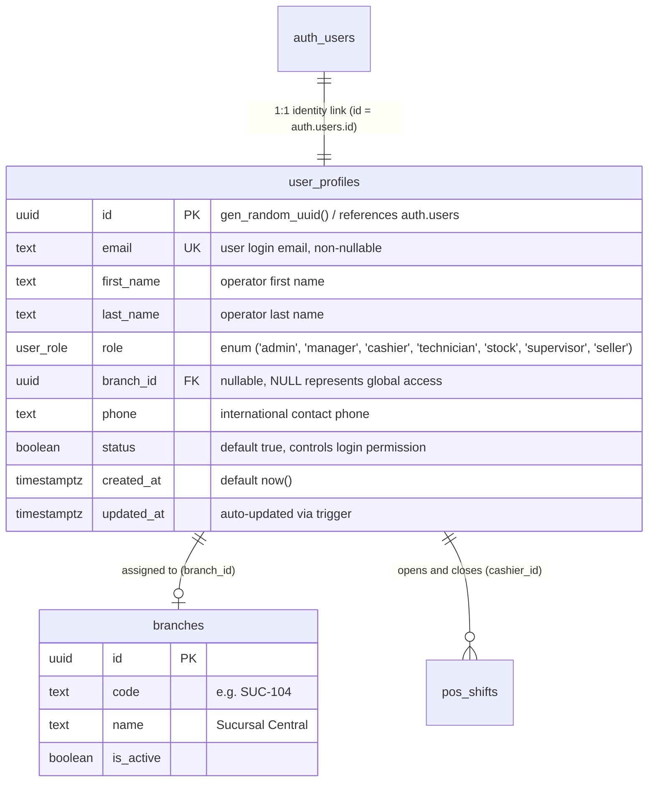
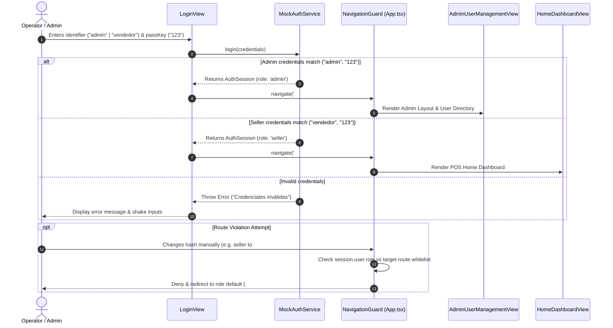

# System Specification: Admin User Management & Role-Based Access Control (RBAC)

## 1. Executive Summary

- **Objective:** Establish the administrative User Management module (CRUD directory and "Add New User" modal) adapted from the approved Stitch UI designs (`specifications/user-crud-managemnt` and `specifications/add-new-user`), while implementing a strict Role-Based Access Control (RBAC) dual-profile authentication engine with isolated seller (`vendedor`) and administrator (`admin`) domains.
- **Scope (In-Scope):**
  - **RE#1 Admin User Directory (CRUD UI):** High-density administrative workspace featuring KPI operational metrics (Total Users, Active Users, Cashiers & Terminals, Active Shift Sessions), real-time search (by name, email, phone, or UUID), multi-criteria filters (Role, Branch, Status), a collapsible database schema visualizer (`public.user_profiles`), and a tabular user list with inline action triggers (Edit, Toggle Status, Copy UUID).
  - **RE#2 "Add New User" Modal:** Modal dialog triggered by "+ Nuevo Usuario" that captures user identity (`email`, `first_name`, `last_name`), segmented role selection (`cashier`, `supervisor`, `stock`, `admin`), branch allocation (`branch_id`), phone number (`phone`), and active initial status toggle (`status`), with local mock state persistence.
  - **RE#3 Dual Hardcoded Profiles & Route Isolation:** Inclusion of an administrative hardcoded profile (`admin` / `123`) alongside the existing seller profile (`vendedor` / `123`), paired with bidirectional route guards preventing seller accounts from accessing admin management portals and vice versa.
- **Out-of-Scope:**
  - Live Supabase PostgreSQL database connections and remote Edge Function execution (temporarily decoupled; mocked via an in-memory/browser-persisted client-side store).
  - Remote SMTP verification emails or transactional invite delivery.
  - Multi-factor authentication (MFA/TOTP) and hardware security keys.
- **Assumptions:**
  - The application uses React 19, TypeScript, Tailwind CSS v4, Lucide React icons, and a hash-based navigation router (`#admin/users`, `#seller/home`, etc.).
  - Mock users created via the UI are retained in browser session/local storage to enable immediate testing of CRUD cycles prior to backend Supabase synchronization.

---

## 2. User Roles and Actors

| Role Identifier | Display Name | Allowed Views / Routes | Restricted Views | Default Credentials |
| :--- | :--- | :--- | :--- | :--- |
| **`admin`** | Admin Root Sistema | `#admin/users`, `#admin/overview`, `#admin/backup`, `#admin/config` | `#seller/home`, `#pos`, `#drawer`, `#history` | `admin` / `123` |
| **`seller`** | Carlos Vendedor | `#seller/home`, `#pos`, `#catalog`, `#drawer`, `#history` | All `#admin/*` routes | `vendedor` / `123` |
| **`cashier`** | Cajero Operativo | POS Terminal (`#pos`), Drawer settlement (`#drawer`) | All `#admin/*` routes | Derived from user creation |
| **`supervisor`** | Supervisor de Turno | POS Terminal, Price Checker, Manager Overrides | All `#admin/*` routes | Derived from user creation |
| **`stock`** | Encargado de Stock | Inventory Catalog & Stock Intake | All `#admin/*` routes | Derived from user creation |

---

## 3. Functional Requirements & User Stories

### Epic 1: Authentication & Role-Based Navigation Guards

#### [RF-01] Dual Hardcoded Profile Authentication
- **Story:** As an administrative user or store clerk, I want to authenticate using dedicated credentials so that the system immediately loads my assigned operational workspace.
- **Criterios de Aceptación (Gherkin):**
  - [ ] **Scenario 1 (Admin Login Success):**
    - **Given** an unauthenticated session on `#login`
    - **When** entering username `admin` and password `123`
    - **Then** the system authenticates the user with role `admin`, stores the session token, and redirects to `#admin/users`.
  - [ ] **Scenario 2 (Seller Login Success):**
    - **Given** an unauthenticated session on `#login`
    - **When** entering username `vendedor` and password `123`
    - **Then** the system authenticates the user with role `seller` and redirects to `#seller/home`.
  - [ ] **Scenario 3 (Invalid Credentials):**
    - **Given** any username and an incorrect password
    - **When** submitting the login form
    - **Then** the system denies access, highlights the input borders in error red, and displays: *"Credenciales inválidas. Verifique su usuario y contraseña"*.

#### [RF-02] Strict Bidirectional Route & View Isolation
- **Story:** As a store administrator, I want strict boundary enforcement between administrative configuration and POS selling screens so that cashiers cannot access or modify user permissions and administrators do not pollute POS shift cash drawers.
- **Criterios de Aceptación (Gherkin):**
  - [ ] **Scenario 1 (Seller Accessing Admin Route Rejected):**
    - **Given** an active session authenticated as `seller`
    - **When** navigating directly to `#admin/users` via URL hash or browser address bar
    - **Then** the navigation guard intercepts the attempt, prevents view rendering, and redirects to `#seller/home`.
  - [ ] **Scenario 2 (Admin Accessing Seller Route Rejected):**
    - **Given** an active session authenticated as `admin`
    - **When** navigating directly to `#pos` or `#seller/home`
    - **Then** the navigation guard intercepts the attempt and routes the user back to `#admin/users`.
  - [ ] **Scenario 3 (Logout Clears Route Access):**
    - **Given** an active session for any role
    - **When** clicking the logout action in the TopBar or Sidebar
    - **Then** all session tokens are purged from memory and storage, and the app resets to `#login`.

---

### Epic 2: Admin User Management Directory (CRUD View)

#### [RF-03] Administrative Operational Layout & KPI Metrics
- **Story:** As an administrator, I want an executive dashboard header with system health cards so that I can monitor total staff counts, terminal assignments, and active shifts at a glance.
- **Criterios de Aceptación (Gherkin):**
  - [ ] **Scenario 1 (KPI Metrics Computation):**
    - **Given** a collection of user profile records in the local state
    - **When** the `#admin/users` view is mounted
    - **Then** the interface calculates and renders 4 KPI metric cards:
      1. *Total Usuarios*: Count of all records.
      2. *Usuarios Activos*: Count of records where `status === true`.
      3. *Cajeros & Terminales*: Count of records where `role === 'cashier'`.
      4. *En Turno Ahora*: Count of operators currently logged into terminal sessions.

#### [RF-04] User Table Querying, Filtering & Search
- **Story:** As an administrator, I want to search and filter the staff directory by text, role, branch, and active status so that I can quickly locate specific operators in high-density teams.
- **Criterios de Aceptación (Gherkin):**
  - [ ] **Scenario 1 (Multi-Field Search):**
    - **Given** a user list with mixed identities
    - **When** typing query string `"Vega"` in the search input
    - **Then** the table immediately filters rows matching `first_name`, `last_name`, `email`, `phone`, or `id` (case-insensitive) with zero UI lag (< 50ms).
  - [ ] **Scenario 2 (Combined Dropdown Filtering):**
    - **Given** active filters `Role: Cajero` and `Estado: Activos`
    - **When** viewing the table body
    - **Then** only users fulfilling both criteria are rendered, displaying an empty state banner if no matches are found.

#### [RF-05] Schema Inspection Drawer & Column Metadata
- **Story:** As an administrator and database architect, I want to toggle an interactive PostgreSQL schema blueprint so that I can inspect the underlying table constraints (`public.user_profiles`) and column types.
- **Criterios de Aceptación (Gherkin):**
  - [ ] **Scenario 1 (Toggle Schema Banner):**
    - **Given** the user management header
    - **When** clicking the *"Cols Schema (10)"* button
    - **Then** a styled card smoothly expands showing the 10 data columns (`id`, `email`, `first_name`, `last_name`, `role`, `branch_id`, `phone`, `status`, `created_at`, `updated_at`) with their respective PostgreSQL types and constraints.

---

### Epic 3: User Creation Modal & State Management

#### [RF-06] "Nuevo Usuario" Creation Modal Trigger & Form Controls
- **Story:** As an administrator, I want to open an accessible modal dialog when clicking "+ Nuevo Usuario" to register a new system operator.
- **Criterios de Aceptación (Gherkin):**
  - [ ] **Scenario 1 (Open and Close Modal):**
    - **Given** the user directory view `#admin/users`
    - **When** clicking the `+ Nuevo Usuario` primary button
    - **Then** an animated overlay backdrop and modal dialog appear centered with autofocus on the Email input field.
    - **When** pressing `Escape` or clicking `Cancelar` or the close icon `X`
    - **Then** the modal closes and form inputs are reset without persisting data.
  - [ ] **Scenario 2 (Role Selector Micro-interaction):**
    - **Given** the open user creation modal
    - **When** clicking one of the role cards (`Cajero`, `Supervisor`, `Stock`, `Admin`)
    - **Then** the active card highlights with the primary container color and updates the internal form state, deselecting previous choices.

#### [RF-07] User Creation Validation & Local State Persistence
- **Story:** As an administrator, I want input validation and instant state update upon submitting a new user form so that the directory updates immediately without page reloads.
- **Criterios de Aceptación (Gherkin):**
  - [ ] **Scenario 1 (Valid Form Submission):**
    - **Given** valid inputs: `email: "ana.martinez@voltacc.pos"`, `first_name: "Ana"`, `last_name: "Martinez"`, `role: "cashier"`, `branch_id: "Sucursal Central #104"`, and `status: true`
    - **When** clicking `+ Crear Usuario`
    - **Then** the system generates a standard UUID v4 for `id`, sets ISO-8601 `created_at` and `updated_at` timestamps, appends the record to the in-memory/localStorage store, closes the modal, and renders a success toast.
  - [ ] **Scenario 2 (Validation Errors on Missing Required Fields):**
    - **Given** an empty email field or invalid email format
    - **When** attempting submission
    - **Then** the form prevents submission, highlights the invalid input, and displays an informative validation hint.

---

## 4. Architecture and Data Model (High-Level)

### 4.1 System Entities & PostgreSQL Schema Blueprint

The module models the database structure defined for Supabase's `public.user_profiles` linked with Supabase Auth:



### 4.2 TypeScript Type Definitions (`src/types/auth.ts` & `src/types/user.ts`)

```typescript
export type UserRole =
  | 'admin'
  | 'manager'
  | 'cashier'
  | 'technician'
  | 'stock'
  | 'supervisor'
  | 'seller'
  | 'customer';

export interface UserProfileRecord {
  id: string;
  email: string;
  firstName: string;
  lastName: string;
  role: UserRole;
  branchId: string | null;
  branchName?: string;
  phone?: string;
  status: boolean;
  avatarInitials: string;
  createdAt: string;
  updatedAt: string;
}

export interface CreateUserInput {
  email: string;
  firstName: string;
  lastName: string;
  role: UserRole;
  branchId: string | null;
  phone?: string;
  status: boolean;
}
```

### 4.3 Authentication Flow & RBAC Guard Sequence



---

## 5. Non-Functional Requirements (NFRs)

- **Security & Authorization (RBAC):**
  - Session tokens and role identities are verified on every hash change event.
  - Route guards run synchronously before view component mounting to eliminate layout flashing or information leakage.
  - Hardcoded profile passwords in mock mode must simulate a 250ms hashing/network delay to replicate real-world authentication latency.
- **Performance & Responsiveness:**
  - Client-side search and filtering across the user directory must execute in `< 16ms` (maintaining 60 FPS) for datasets up to 1,000 records.
  - Modals and schema visualizers must utilize GPU-accelerated CSS transitions (`transform`, `opacity`, `backdrop-filter`).
- **Design System Consistency:**
  - The UI must strictly follow the Material-inspired *Kinetic Retail POS* design system tokens present in `specifications/user-crud-managemnt/DESIGN.md`:
    - **Surface colors:** `#faf8ff` (surface), `#f2f3ff` (surface-container-low), `#eaedff` (surface-container), `#ffffff` (surface-container-lowest).
    - **Brand colors:** `#006194` (primary), `#007bb9` (primary-container), `#0051d5` (secondary), `#00855b` (tertiary-container / success).
    - **Typography:** Space Grotesk for headlines, Hanken Grotesk for body text, and JetBrains Mono for codes/UUIDs/metrics.
- **Error Handling & Feedback:**
  - Form validation must provide inline feedback for duplicate emails, empty required fields, and malformed phone numbers.
  - Table empty states must display actionable clear-filter buttons when no records match filter criteria.

---

## 6. Suggested Implementation Plan (Phases)

### Phase 1: Authentication Engine & Dual Profile Support
1. Update `src/types/auth.ts` to expand `UserRole` with `'supervisor' | 'stock'` and ensure `'admin'` has explicit permission scopes.
2. Extend `MockAuthService` in `src/services/authService.ts`:
   - Define `DEFAULT_ADMIN_PROFILE` (`id: 'usr-admin-root'`, `username: 'admin'`, `role: 'admin'`, `displayName: 'Admin Root Sistema'`).
   - Validate credentials for `admin` / `123` and generate appropriate session tokens.
3. Update `App.tsx` navigation guards:
   - Expand `NavigationTab` to include `'admin/users'`, `'admin/overview'`, etc.
   - Implement role-specific redirection: `admin` defaults to `'admin/users'`, `seller` defaults to `'seller/home'`.
   - Prevent cross-role route hijacking.

### Phase 2: Admin Navigation Shell & User Directory Component
1. Build `AdminSidebar.tsx` and `AdminTopBar.tsx` (or adapt `Sidebar.tsx` and `TopBar.tsx` with role conditionals) matching the Stitch UI specifications.
2. Implement `AdminUserManagementView.tsx`:
   - KPI metrics row (Total Users, Active, Cashiers, On Shift).
   - Filter and Search control toolbar.
   - Collapsible PostgreSQL Schema (`public.user_profiles`) inspect drawer.
   - High-density user table with status badges, role indicators, and action buttons.

### Phase 3: "Add New User" Modal & Mock State Store
1. Create `CreateUserModal.tsx` matching `specifications/add-new-user/code.html`:
   - Inputs for email, first name, last name, phone, branch select, and status toggle.
   - Interactive role selector pill cards (`cashier`, `supervisor`, `stock`, `admin`).
2. Implement `userManagementStore.ts` (or integrate into `posStore.ts`):
   - Seed with initial mock users extracted from the Stitch HTML mockup (28 users total, with primary rows: Mateo Rossi, Camila Gomez, Lucas Perez, Admin Root).
   - Implement `addUser`, `updateUser`, and `toggleUserStatus` actions with `localStorage` fallback persistence.

---

## 7. Open Questions / Pending Decisions

1. **Supabase Migration Strategy:** When connecting to real Supabase, should user creation trigger the Supabase Admin API (`supabase.auth.admin.createUser`) via a Secure Edge Function with service-role privileges, or will standard email invitations (`inviteUserByEmail`) be utilized? *(Recommended: Edge Function RPC for instant POS terminal provisioning)*.
2. **Terminal PIN vs Password for Cashiers:** In future sprints, should cashier and supervisor roles authenticate via a 4-digit numeric PIN on POS hardware instead of full email/password credentials? *(Design currently supports both via optional PIN fields)*.
3. **Supervisor Permission Overrides:** Should the `supervisor` role have access to inline discount approvals directly from the POS Terminal screen?

