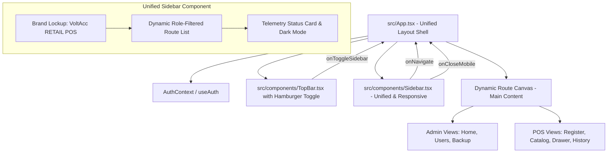
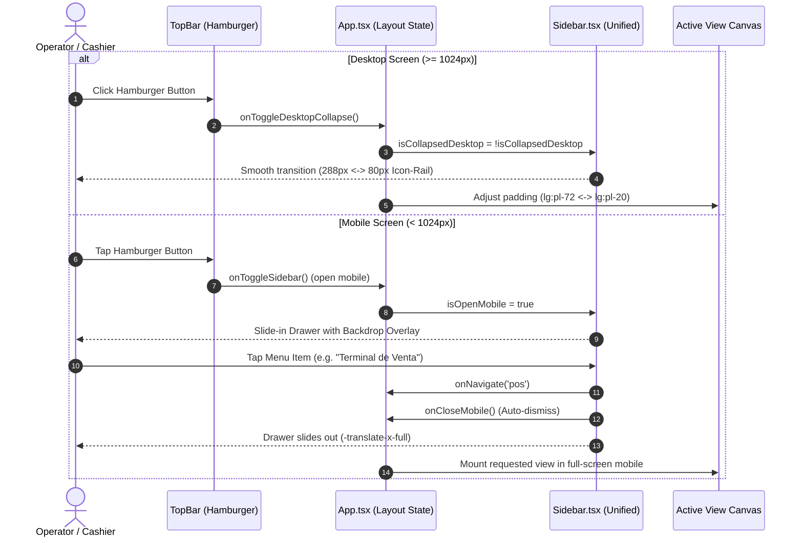

# System Specification: Unified Sidebar Navigation & Mobile Ergonomics

## 1. Executive Summary

- **Objective:** Consolidate the application's navigation sidebar (`<aside>`) into a single modular, reusable component across all user roles (Admin, Manager, Cashier/Seller, Technician, and future profiles), eliminating redundant inline sidebar code in administrative views. Enforce the official VoltAcc Kinetic visual design (`src/components/Sidebar.tsx`), integrate a desktop dual-state retraction into an 80px Icon-Rail (Option B) with prominent active item highlighting, and deliver a first-class, touch-friendly mobile drawer experience optimized for smartphones and tablets.
- **Scope (In-Scope):**
  - **[RF-01] Unified Reusable Component:** Extract and consolidate the navigation sidebar into `src/components/Sidebar.tsx`, mounted centrally within the main layout shell in `src/App.tsx`.
  - **[RF-02] Removal of Embedded Admin Sidebars:** Deprecate and remove redundant inline `<aside>` elements from `AdminHomeDashboardView.tsx`, `AdminUserManagementView.tsx`, and `AdminBackupRecoveryView.tsx`.
  - **[RF-03] Role-Based Dynamic Navigation (RBAC):** Contextual route rendering dynamically driven by the authenticated user's role (`admin`, `manager`, `cashier`/`seller`, `technician`).
  - **[RF-04] Kinetic Design Fidelity:** Strict adherence to Tailwind CSS v4 design tokens, VoltAcc brand typography, corporate blue accents (`#007bb9` / `#006194`), rounded Zap brand lockup, operational badges, and status telemetry card.
  - **[RF-05] Desktop Dual-Mode Collapse (Option B: 80px Icon-Rail):** 
    - **Expanded Desktop (`w-72` / 288px):** Full brand lockup, section text headers, item labels, and bottom telemetry card.
    - **Collapsed Desktop (`w-20` / 80px):** Streamlined vertical icon-rail hiding text and centering icons with native tooltips.
    - **Active View Indicator:** High-contrast corporate blue pill (`bg-[#007bb9]`), white icon, subtle shadow, and a left-aligned vertical active indicator tab.
  - **[RF-06] Smartphone & Mobile Touch Ergonomics:**
    - Off-canvas drawer overlay (`translate-x-0` vs `-translate-x-full`) with a semitransparent blurred backdrop (`backdrop-blur-xs`).
    - Minimum touch targets of 44x44px (compliant with WCAG 2.1 AA and iOS/Android ergonomics).
    - Auto-dismiss drawer behavior on route selection to immediately reveal the requested mobile workspace.
    - Full viewport height (`100dvh` / `h-full`) supporting safe-area insets (`env(safe-area-inset-bottom)`) to prevent interference with mobile home indicator bars.
- **Out-of-Scope:**
  - Supabase database schema migrations or PostgreSQL Row-Level Security (RLS) modifications.
  - New business modules, sales workflows, or administrative CRUD views not currently specified.
  - Automated testing suites (unit, integration, or E2E), strictly adhering to repository engineering guidelines; verification is performed manually in the browser.
- **Assumptions:**
  - Frontend stack: React 19, TypeScript, Vite, Tailwind CSS v4, Motion, and Lucide React.
  - Session state, role data, and theme toggle are consumed via `useAuth()` (`AuthContext.tsx`).

---

## 2. Actors and User Roles

| Role Identifier | Role Label | Permitted Sidebar Routes | Default Landing View |
| :--- | :--- | :--- | :--- |
| **`admin`** | Super Admin / Admin root | Metrics & Logs (`admin/home`), User Management (`admin/users`), Backup & Recovery (`admin/backup`), Settings (`admin/config`) | `#admin/home` |
| **`manager`** | Store Manager | Branch Overview (`manager/home`), Cash Drawer (`drawer`), Catalog & Stock (`catalog`), Branch Staff | `#manager/home` |
| **`cashier` / `seller`** | Cashier / Sales Operator | Home (`seller/home`), POS Terminal (`pos`), Catalog & Stock (`catalog`), Cash Drawer (`drawer`), Sales History (`history`) | `#seller/home` / `#pos` |
| **`technician`** | Service Technician | Repair Workshop (`workshop`), Spare Parts Catalog (`catalog`), Active Orders | `#workshop` |

---

## 3. Functional Requirements & User Stories

### [RF-01] Unified Reusable Sidebar Architecture
- **Story:** As a software engineer and platform user, I want a single modular navigation sidebar component so that all roles share the same layout infrastructure without code duplication or visual drift.
- **Acceptance Criteria (Gherkin):**
  - [ ] **Scenario 1 (Centralized mounting in layout):**
    - **Given** an authenticated user with any valid role (`admin`, `manager`, or `cashier`)
    - **When** the application renders the authenticated shell in `src/App.tsx`
    - **Then** the sidebar is rendered exclusively through the shared `src/components/Sidebar.tsx` component
    - **And** child views (`AdminHomeDashboardView`, `POSTerminalView`, etc.) render inside the main canvas without declaring their own `<aside>` elements.
  - [ ] **Scenario 2 (Zero redundant sidebars in views):**
    - **Given** the source code of `AdminHomeDashboardView.tsx`, `AdminUserManagementView.tsx`, and `AdminBackupRecoveryView.tsx`
    - **When** the JSX structure is inspected
    - **Then** none of these components contain a local `<aside>` or standalone 80px icon-rail markup.

---

### [RF-02] Dynamic Role-Based Route Filtering (RBAC)
- **Story:** As an authenticated POS operator (Administrator, Cashier, or Technician), I want to see only the menu options relevant to my role so that my interface remains uncluttered and secure.
- **Acceptance Criteria (Gherkin):**
  - [ ] **Scenario 1 (Administrator navigation menu):**
    - **Given** an authenticated user with role `admin`
    - **When** the sidebar mounts
    - **Then** it displays:
      - *Overview & Metrics* (`admin/home` - Icon `BarChart3`)
      - *User Directory* (`admin/users` - Icon `UserCog`)
      - *Backup & Recovery* (`admin/backup` - Icon `RotateCcw`)
      - *Configuration* (`admin/config` - Icon `Sliders`)
    - **And** cashier-only routes (`pos`, `drawer`) are omitted from the navigation list.
  - [ ] **Scenario 2 (Cashier / Seller navigation menu):**
    - **Given** an authenticated user with role `cashier` or `seller`
    - **When** the sidebar mounts
    - **Then** it displays:
      - *Seller Home* (`seller/home` / `home` - Icon `Home`)
      - *Sales Terminal* (`pos` - Icon `Store`)
      - *Catalog & Stock* (`catalog` - Icon `Boxes`)
      - *Cash Drawer Settlement* (`drawer` - Icon `LockKeyhole`)
      - *Sales History* (`history` - Icon `Receipt`)
    - **And** administrative routes (`admin/*`) are hidden and inaccessible.

---

### [RF-03] Visual Design & VoltAcc Brand Fidelity
- **Story:** As a user, I want the sidebar to strictly maintain the established VoltAcc Kinetic design system so that the brand visual identity is uniform across the entire platform.
- **Acceptance Criteria (Gherkin):**
  - [ ] **Scenario 1 (Consistent brand lockup):**
    - **Given** any authenticated profile
    - **When** the sidebar is expanded
    - **Then** the header displays the rounded VoltAcc icon box (white `Zap` icon on `#007bb9` background), title *"VoltAcc"*, and subtitle *"RETAIL POS"*.
  - [ ] **Scenario 2 (Interactive navigation states):**
    - **Given** an active route item
    - **When** rendered in the list
    - **Then** it features the corporate background (`bg-[#007bb9]` or `bg-[#006194]`), white typography, and white icon
    - **And** inactive items display distinct hover feedback compatible with light and dark modes.
  - [ ] **Scenario 3 (Contextual footer telemetry card):**
    - **Given** the bottom area of the sidebar in expanded mode
    - **When** inspected
    - **Then** it displays node/cashier status (*"Caja 02 • Turno Activo"* for cashiers, or *"Consola Central • Super Admin"* for administrators), the green online indicator dot, and the dark mode toggle switch.

---

### [RF-04] Desktop Dual-Mode Collapse (Option B: 80px Icon-Rail)
- **Story:** As a desktop POS operator, I want to toggle the sidebar between expanded (288px) and compact (80px) states using a hamburger button so that I can maximize horizontal workspace on compact screens while retaining immediate access to all tools.
- **Acceptance Criteria (Gherkin):**
  - [ ] **Scenario 1 (Desktop state toggling - Option B):**
    - **Given** the application running on desktop screens (`lg:` breakpoint >= 1024px)
    - **When** the user clicks the hamburger toggle button in the `TopBar`
    - **Then** the sidebar transitions smoothly between:
      - **Expanded State (`w-72` / 288px):** Displays brand typography, item labels, and full telemetry card.
      - **Collapsed State (`w-20` / 80px):** Hides brand text and labels, vertically centering the icon rail.
    - **And** the main content canvas dynamically animates its left padding (`lg:pl-72` when expanded vs `lg:pl-20` when collapsed).
  - [ ] **Scenario 2 (Mandatory active item highlighting in Icon-Rail mode):**
    - **Given** the sidebar in collapsed 80px mode
    - **When** displaying the item corresponding to the current route (`currentTab`)
    - **Then** the active item is clearly highlighted:
      - Sized at 48x48px (`w-12 h-12`), centered with corporate blue background (`bg-[#007bb9]`) and crisp white icon.
      - Displays an active vertical indicator pill on its left edge.
      - Displays native tooltip text (`title="Route Name"`) upon mouse hover.
    - **And** inactive icons display transparent backgrounds with subtle hover states (`hover:bg-[#eaedff] dark:hover:bg-[#1e293b]`).

---

### [RF-05] Smartphone & Mobile Touch Optimization
- **Story:** As a store operator using a smartphone or handheld terminal, I want the sidebar to adapt comfortably to small screens with touch-friendly controls so that I can navigate effortlessly without accidental clicks or layout distortion.
- **Acceptance Criteria (Gherkin):**
  - [ ] **Scenario 1 (Off-canvas drawer on mobile viewports):**
    - **Given** a mobile viewport (`< 1024px` / mobile smartphones)
    - **When** the user taps the hamburger button in `TopBar`
    - **Then** the sidebar slides in from the left as an off-canvas drawer (`translate-x-0`) above all page content (`z-50`)
    - **And** a dark backdrop with blur (`bg-[#283044]/40 backdrop-blur-xs`) covers the viewport behind the drawer.
  - [ ] **Scenario 2 (Ergonomic touch targets >= 44x44px):**
    - **Given** the mobile drawer open on a smartphone
    - **When** the operator touches any navigation item or action button
    - **Then** every interactive element has a minimum touch target area of 44x44px (with `min-h-[44px]` and comfortable vertical padding) to prevent miss-taps.
  - [ ] **Scenario 3 (Automatic drawer dismissal on navigation):**
    - **Given** the mobile drawer open on a smartphone
    - **When** the user taps a navigation link (e.g., *"Terminal de Venta"* or *"Gestión de Usuarios"*)
    - **Then** the application triggers the route transition (`onNavigate`)
    - **And** automatically closes the mobile drawer (`onCloseMobile`), restoring full-screen visibility to the selected view.
  - [ ] **Scenario 4 (Touch dismiss and mobile safe areas):**
    - **Given** the mobile drawer open
    - **When** the user taps outside the drawer on the backdrop or presses the top-right `X` button
    - **Then** the drawer smoothly retracts off-screen (`-translate-x-full`)
    - **And** the drawer container uses dynamic viewport units (`100dvh` / `h-full`) with bottom safe-area padding (`pb-[env(safe-area-inset-bottom,16px)]`) to prevent controls from overlapping mobile system home indicators.

---

## 4. Component Architecture & Data Contracts

### 4.1. Component Relationship Hierarchy



### 4.2. TypeScript Contract for `Sidebar.tsx`

```typescript
import { NavigationTab } from '../types/pos';
import { UserRole } from '../types/auth';

export interface NavigationItem {
  id: NavigationTab;
  label: string;
  icon: React.ComponentType<{ className?: string }>;
  roles: UserRole[];
  badge?: string;
}

export interface SidebarProps {
  currentTab: NavigationTab;
  onNavigate: (tab: NavigationTab) => void;
  isCollapsedDesktop: boolean;
  isOpenMobile: boolean;
  onCloseMobile: () => void;
  onToggleDesktopCollapse?: () => void;
  darkMode?: boolean;
  onToggleDarkMode?: () => void;
}
```

### 4.3. Navigation & Interaction Sequence Diagram



---

## 5. Non-Functional Requirements (NFRs)

- **Performance & Frame Rate:** Transitions between expanded, collapsed, and mobile drawer states must execute at 60 FPS utilizing hardware-accelerated CSS properties (`transform`, `translate3d`, and Tailwind's `transition-all duration-300 ease-in-out`).
- **Touch Ergonomics & Accessibility:** 
  - All interactive touch targets on mobile viewports must meet or exceed 44x44px.
  - Visual focus indicators (`focus:ring-2 focus:ring-[#007bb9]`) for keyboard accessibility.
  - Interactive icons and buttons must include descriptive `aria-label` and native `title` tags for screen readers and tooltips.
- **Responsiveness Across Form Factors:**
  - **Smartphone (`< 640px`):** Off-canvas drawer overlay, full touch optimization, auto-closing upon item selection.
  - **Tablet (`640px - 1023px`):** Drawer overlay or collapsible rail adapting to landscape/portrait orientation.
  - **Desktop (`>= 1024px`):** Dual-mode sidebar (288px expanded vs 80px Icon-Rail) with synchronous main canvas padding adjustment.
- **Clean Architecture & Maintainability:** The role-to-route mapping is maintained as a declarative configuration array (`NAV_ITEMS`), allowing engineers to add or adjust menu items in under 5 minutes without modifying component layout logic.

---

## 6. Phased Implementation Roadmap

1. **Phase 1: Unified `Sidebar.tsx` Refactoring & RBAC Filtering:**
   - Define the comprehensive `NAV_ITEMS` array with associated `roles: UserRole[]`.
   - Filter visible items dynamically based on `user?.role`.
   - Integrate `isCollapsedDesktop` prop to switch between `w-72` and `w-20` on desktop.
2. **Phase 2: Icon-Rail Mode & Active View Highlight:**
   - Center icons in `w-20` mode and hide labels cleanly (`overflow-hidden whitespace-nowrap`).
   - Implement the prominent active pill indicator (`bg-[#007bb9]` with white icon and vertical left tab) for the current view in both modes.
3. **Phase 3: Smartphone & Mobile Touch Adaptation:**
   - Enhance mobile drawer markup with `h-[100dvh]`, safe-area bottom padding, and auto-dismiss upon clicking any navigation link.
   - Ensure all touch targets measure >= 44x44px.
4. **Phase 4: Deprecate Redundant Admin Sidebars:**
   - Remove inline `<aside>` blocks from `AdminHomeDashboardView.tsx`, `AdminUserManagementView.tsx`, and `AdminBackupRecoveryView.tsx`.
   - Remove hardcoded left offsets (`lg:pl-20`) inside admin views so they inherit the layout's dynamic padding.
5. **Phase 5: Layout Shell Integration & Browser Verification:**
   - Centralize layout in `src/App.tsx`, providing consistent `Sidebar` and `TopBar` across all user roles.
   - Perform manual verification in browser: test desktop toggling, mobile smartphone viewports (touch and backdrop), role routing, and theme switching.

---

## 7. Confirmed Architectural Decisions

1. **Desktop Collapse Behavior (Option B Confirmed):**
   - The desktop hamburger button collapses the sidebar into an **80px Icon-Rail (`w-20`)**, keeping all tool icons accessible without completely vacating the left rail.
   - **Active View Highlighting:** The active route icon is prominently highlighted with corporate blue styling (`bg-[#007bb9]`), white iconography, and an active side tab.
   - Main content dynamically transitions between `lg:pl-72` and `lg:pl-20`.
2. **Smartphone Drawer Standard:**
   - On viewports `< 1024px`, the menu operates as a full-height off-canvas drawer with backdrop overlay.
   - Tapping any item auto-dismisses the drawer and navigates immediately.
3. **Session & Profile Controls:**
   - User profile details, branch badges, and the primary sign-out button remain located in the top navigation bar (`TopBar`), keeping the collapsed sidebar lean and uncluttered.
