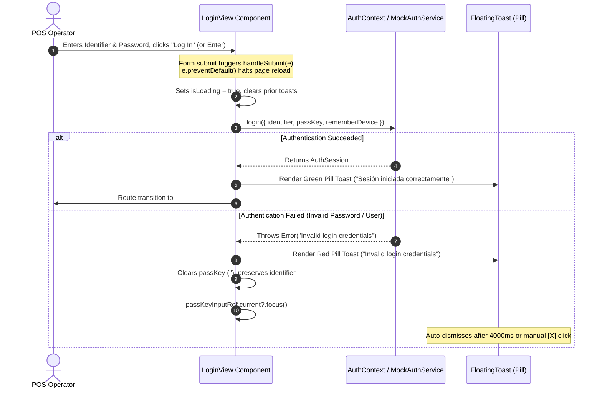

# System Specification: POS Login Feedback & Toast Notification System


## 1. Executive Summary

- **Objective:** Fix a critical UX bug in the POS operator login flow where entering an invalid password triggers an uncontrolled browser page reload, wipes form context, and leaves the user without actionable feedback. The solution eliminates page refreshes on submission and implements a floating pill toast notification system (red for errors, green for success) strictly modeled after the visual design reference.
- **In-Scope:**
  - Prevent default browser form submission refresh on all authentication attempts.
  - Retain the entered operator identifier / email upon failed authentication.
  - Automatically clear and refocus the password input field on failed authentication.
  - Implement a reusable or dedicated floating pill-shaped toast notification component matching the provided UI reference:
    - **Failure Toast:** Vibrant red background (`bg-rose-500` / `bg-red-600`), circular alert icon (`!`), dynamic error description (e.g., `"Invalid login credentials"`), and dismiss (`X`) button.
    - **Success Toast:** Vibrant emerald green background (`bg-emerald-600`), circular checkmark icon (`✓`), success description (e.g., `"Sesión iniciada con éxito"` / `"Login successful"`), and dismiss button.
  - Smooth entrance and exit animations (using `motion` or CSS transitions) with auto-dismiss timer (default 4000ms) and manual dismiss capability.
- **Out-of-Scope:**
  - Backend authentication endpoint / Supabase schema modifications (handled in separate migrations).
  - Password recovery workflow changes (handled by the existing supervisor PIN modal).
- **Assumptions:**
  - Frontend stack remains React 19, TypeScript, Tailwind CSS v4, Lucide React, and Motion.
  - Default auto-dismiss timeout is 4000ms, paused when the user hovers over the toast.

---

## 2. Actors & User Roles

- **POS Operator / Cashier:** Interacts with the login view daily to authenticate into their assigned physical checkout terminal. Requires instantaneous feedback on typo errors without losing their entered identifier.
- **Store Manager / Supervisor:** Requires clear security feedback when authentication is rejected due to invalid credentials, deactivated accounts, or locked terminals.

---

## 3. Functional Requirements & User Stories

### [FR-01] Non-Reloading Form Submission & State Management
- **User Story:** As a POS Operator, I want the login form to validate my credentials asynchronously without refreshing the browser page, so that I don't lose the operator identifier I already typed.
- **Acceptance Criteria:**
  - [ ] **Scenario 1 (Prevent Full Page Refresh):** Given the user is on the login page, When the user submits the form via the "Entrar al Sistema" button or pressing `Enter`, Then the browser must not perform a document navigation or full reload (`e.preventDefault()`).
  - [ ] **Scenario 2 (Retain Identifier & Clear Password):** Given the user enters `"vendedor"` and an invalid password `"wrongpass"`, When the authentication request rejects, Then the identifier `"vendedor"` remains populated in the input field, the password input is cleared to `""`, and focus is returned immediately to the password input field.

### [FR-02] Floating Pill Error Toast Notification (Red)
- **User Story:** As a POS Operator, I want a prominent red toast notification when my credentials fail, so that I immediately understand why authentication was denied.
- **Acceptance Criteria:**
  - [ ] **Scenario 1 (Failed Login Visual Feedback):** Given the user enters incorrect credentials, When login fails, Then a floating pill toast appears at the top-center of the viewport with a red background, a circular alert icon (`AlertCircle`), the specific error message (e.g., `"Invalid login credentials"` or backend error reason), and a white dismiss cross (`X`).
  - [ ] **Scenario 2 (Manual Dismissal):** Given an active error toast is visible, When the user clicks the dismiss (`X`) button, Then the toast immediately animates out and is unmounted.
  - [ ] **Scenario 3 (Automatic Dismissal):** Given an active error toast is visible, When 4000ms elapse without user interaction, Then the toast smoothly fades out.

### [FR-03] Floating Pill Success Toast Notification (Green)
- **User Story:** As a POS Operator, I want visual confirmation of successful authentication before transitioning into the terminal workspace, so that I know my session has been initialized.
- **Acceptance Criteria:**
  - [ ] **Scenario 1 (Successful Login Feedback):** Given valid operator credentials, When login succeeds, Then a floating pill toast appears with an emerald green background, a circular checkmark icon (`CheckCircle2`), and message `"Sesión iniciada correctamente"`, displaying briefly before or during the view transition to `/seller/home`.

---

## 4. Architecture & Component Design (High-Level)

### 4.1 Component Contracts

```typescript
export type ToastType = 'error' | 'success' | 'info';

export interface ToastState {
  id: string;
  type: ToastType;
  message: string;
  duration?: number;
}

export interface FloatingToastProps {
  toast: ToastState | null;
  onDismiss: () => void;
}
```

### 4.2 Visual Design Specifications (Reference Matching)

| Attribute | Specification | Tailwind CSS v4 Utility |
| :--- | :--- | :--- |
| **Shape** | Full pill container | `rounded-full` |
| **Padding** | Balanced horizontal padding | `px-5 py-2.5` |
| **Position** | Floating top-center, fixed z-index | `fixed top-6 left-1/2 -translate-x-1/2 z-50` |
| **Error Palette** | Vibrant red / rose with soft shadow | `bg-red-500 dark:bg-red-600 text-white shadow-lg shadow-red-500/25` |
| **Success Palette** | Vibrant emerald green with soft shadow | `bg-emerald-600 text-white shadow-lg shadow-emerald-600/25` |
| **Left Icon** | Circle badge with icon | Semi-transparent circular background: `w-6 h-6 rounded-full bg-white/20 flex items-center justify-center` |
| **Typography** | Medium-weight clean sans-serif | `text-sm font-medium text-white select-none` |
| **Close Button** | Minimalist X icon with hover fade | `w-4 h-4 text-white/80 hover:text-white transition-opacity cursor-pointer ml-3` |
| **Animation** | Slide-down + fade-in / slide-up + fade-out | Handled via `motion.div` (`initial={{ y: -20, opacity: 0 }} animate={{ y: 0, opacity: 1 }} exit={{ y: -20, opacity: 0 }}`) |

### 4.3 Form Submission & State Flow



---

## 5. Non-Functional Requirements (NFRs)

- **Zero Full Page Reloads:** Submission handling must guarantee `event.preventDefault()` under all circumstances, including form submission triggered via keyboard shortcut (`Enter`), mouse click on button, or virtual keyboard actions.
- **Latency & Responsiveness:** The error toast must render and enter the DOM within 16ms (1 screen refresh cycle at 60Hz) following rejection from the authentication promise.
- **Accessibility (WCAG 2.1 AA):**
  - Toast element must declare `role="alert"` and `aria-live="assertive"` for error states.
  - The dismiss button must include `aria-label="Cerrar notificación"` and be reachable via keyboard navigation (`Tab`).
  - Pressing `Escape` while the toast is visible should immediately dismiss it.
- **Responsive Layout:** On mobile viewports (<640px), the toast must maintain a minimum distance of 16px from the screen edges (`max-w-[calc(100vw-2rem)]`), wrapping cleanly if the error string is exceptionally long without breaking pill symmetry.

---

## 6. Phased Implementation Roadmap

1. **Phase 1 (Floating Pill Toast Component):**
   - Create a reusable `FloatingToast.tsx` component matching the exact geometry, typography, and color styling of the reference image.
   - Configure entrance/exit animations using Motion (`motion.div` with `AnimatePresence`).
2. **Phase 2 (LoginView Integration & Bug Resolution):**
   - Audit `handleSubmit` in [LoginView.tsx](file:///c:/Users/nico8/OneDrive/Escritorio/POS/src/components/LoginView.tsx) to ensure zero page-reload leaks.
   - Replace or complement the inline alert banner with the floating red toast.
   - Implement password field reset while retaining the operator identifier and auto-focusing `passKeyInputRef`.
3. **Phase 3 (Success State & Timing Controls):**
   - Wire the green success toast on valid credential resolution before routing to `#seller/home`.
   - Add auto-dismiss timer (4000ms) with timeout cleanup on unmount.
   - Add keyboard `Escape` dismissal listener.

---

## 7. Open Questions & Pending Decisions

1. **Toast Persistence across Navigation:** Should the green success toast stay visible across the route transition into `#seller/home` for 1-2 seconds, or dismiss immediately upon view change? (Recommendation: Allow it to persist for 2 seconds to confirm the active session transition).
2. **Global vs Local Toast Scope:** Should this floating pill toast system be implemented as a global `ToastProvider` for the whole POS (available for sales, cash movements, and catalog updates), or kept local to `LoginView` for this initial bugfix? (Recommendation: Implement as a lightweight standalone component that can easily be promoted to a global `ToastContext`).

